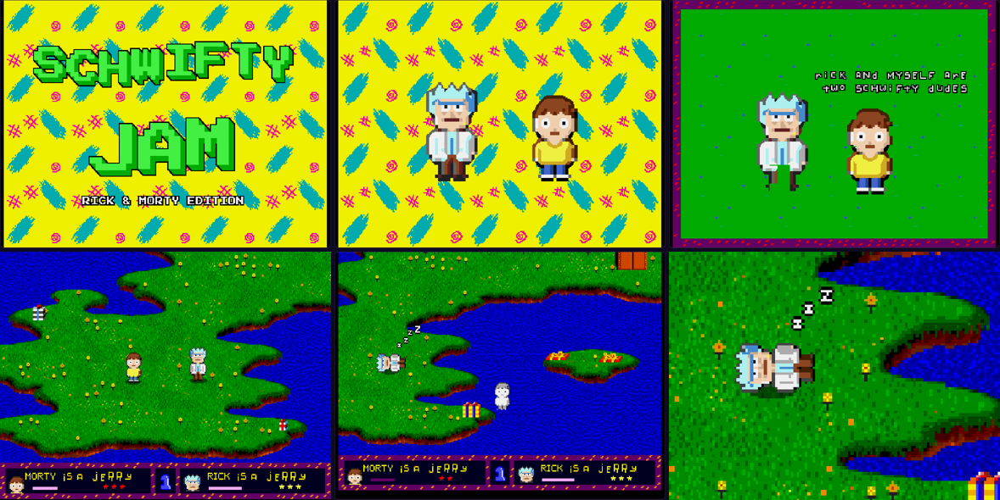
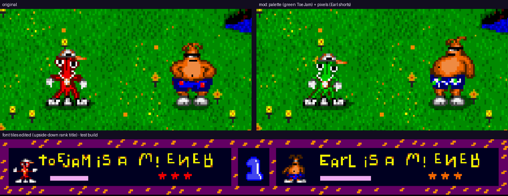

# toejam-mod

Change the art, text, sounds and music of **ToeJam & Earl** (Sega Genesis, REV 02 / "World Rev A"), then play the result in the browser.



The repo has three parts:
- **`tjmod.py`:** the toolkit. Extract the game's sprites, palettes, sounds and text to PNG/WAV/JSON, edit them, and rebuild a ROM plus an `.ips` patch.
- **`ports/rick-and-morty/`:** a complete conversion built with it. Morty and Rick replace ToeJam and Earl, using the sprites of [Schwifty Jam](https://schwifty-jam.vercel.app/).
- **`web/`:** a browser player (EmulatorJS). It applies the patches to your own ROM, in the browser.

**No ROMs or game data are included.** You need your own copy of the game. Mods are shared as `.ips` patches.

## Play in the browser

```
web/serve.sh            # http://localhost:8077
```

Load your ROM; a `.zip` is fine. Then pick **Play Rick & Morty** or **Play the original**. The ROM is checked (SHA-1 `85e8d0a4fac591b25b77c35680ac4175976f251b`), patched in memory and remembered in that browser only. Nothing is uploaded.

`web/` is a static site and can be hosted as is: see `.github/workflows/pages.yml`.

## Setup

```
git clone --recurse-submodules <this repo>
pip install -r requirements.txt     # Pillow
cp "/path/to/ToeJam & Earl (REV 02).md" rom/original.md
```

- **Python:** Python 3.9+ with Pillow.
- **Node:** Node 18+, only for the Rick & Morty port's sprite export.
- **The disassembly:** `tje-disasm/` is [bstreiff/tje-disasm](https://github.com/bstreiff/tje-disasm), a git submodule (`git submodule update --init` if you cloned without it). Its `resources.cfg` and `src/main.S` say where sprites, palettes, sounds and text live; `resources-extra.cfg` here adds animations it doesn't list yet.
- **The ROM:** `rom/original.md` must be REV 02. The tools refuse anything else.

## Make a mod

```
python3 tjmod.py extract                          # ROM -> assets/
# ...edit PNGs / WAVs / palettes.json / text.json in assets/...
python3 tjmod.py build --web web/mod.md           # assets/ -> build/toejam-mod.md (+ .ips)
web/serve.sh                                      # "Play local build"
```

`build` only touches what you changed. With nothing edited, it outputs a ROM identical to the original (same SHA-1).

### What you can edit

| File | What | Rules |
|---|---|---|
| `assets/sprites/*.png` | 312 animations (1,378 frames): ToeJam, Earl, every Earthling, presents, items, intro, ending | Keep the image size. Frames sit side by side and share the animation's origin. |
| `assets/guides/*.png` | Same sheets with the hardware sprite boxes outlined | Reference only. You can only draw **inside** a box; pixels outside are dropped (with a warning). |
| `assets/palettes.json` | The 22 palette lines (16 colors each, `#RRGGBB`) | Colors snap to the Genesis 512-color space. Lines are shared: changing ToeJam's red also changes other red things on line 3. |
| `assets/images/*.png` | Font (two sets), HUD text, level numbers, Sega logo, starfields, title logo tiles | Raw 8x8 tiles in ROM order, 16 per row. Same size, edited in place. Display palettes are best guesses. |
| `assets/sounds/*.wav` | 41 sampled sound effects and voices | Any PCM WAV (mono/stereo, any rate, 8 to 32-bit). It's converted to 8-bit mono at 8.6 kHz. Up to 7.6 s. Longer than the original is fine. |
| `assets/text.json` | All 328 strings: menus, intro story, dialogue, present names, ranks | Shorter or equal: written in place. Longer: moved, if the game reaches the string through a 32-bit pointer (most do; the intro story is reached PC-relative and must fit). |
| `assets/patches.json` | Raw byte patches: `{"addr": "02BDC8", "hex": "..."}` overwrites; `{"label": "x", "hex": "..."}` adds data in the expansion area and `{"addr": "03A538", "ptr": "x"}` points at it | For things without a nicer format, e.g. title-screen tile maps, music or a code operand. Applied last. |
| `assets/relayout.json` | `{"sheets": [...], "frames": ["0B1072", ...], "min_tiles": 24}` | Lets those frames get new hardware sprite boxes fitted to the art (see below). Needs indexed PNGs. |

### How sprite edits work

- **Colors:** each hardware sprite uses one 16-color palette line, and whatever color you paint snaps to the nearest color in its line (taking edits in `palettes.json` into account). To get a genuinely new color, change it in `palettes.json`.
- **Indexed PNGs:** a PNG that keeps the exported 64-color indexed layout is read literally: index L×16+C is color C of line L. If every pixel of a hardware sprite is repainted from another line, the sprite switches to that line.
- **Re-laid-out frames:** frames listed in `relayout.json` aren't limited to the old boxes. Build covers the art with new sprites (up to 32×32 each, one palette line each, separate blobs covered separately). The tile count stays within the original frame's count or `min_tiles`, whichever is larger: the game copies each frame into a fixed video-memory slot. Frames reached through an animation list can gain sprites (the header moves and the list is repointed). Inline frames keep their sprite count.
- **Shadow/highlight:** on sprite palette line 3, colors 14 and 15 are not colors. The game runs the VDP in shadow/highlight mode, so they brighten/darken what's underneath (index 63 is the see-through ground shadow). Paint them on purpose, or not at all.
- **Transparency:** transparent pixels (alpha < 50%, or index 0) erase.
- **Shared frames:** some frames appear in more than one animation; for example, Earl's idle frames also appear in the Funkotron ending. An edit in either sheet changes both, and `build` prints a note when that happens.
- **Inline copies:** the game also embeds frames that reuse catalogued sprite data (sleeping poses, intro/ending copies). These show up as `<sheet>~shared` animations. Edits never leak into them; edit them there.
- **Shared pieces:** pieces shared between *different* frames are split automatically. Editing one frame never changes another frame behind your back.
- **Storage:** edited sprites are recompressed with the game's own RLE formats. If one no longer fits where it was, it moves to an expansion area, the ROM grows to 2 MB (up to 4 MB), and the pointers are updated. Sounds and text work the same way: every pointer to them is updated.

Aseprite, LibreSprite or Pixelorama work well: open the PNGs in indexed mode and you'll be painting with the game's real palette. Any RGBA editor works too.



### Example

`examples/demo_mod.py` makes ToeJam green (a palette change) and gives Earl checkered shorts (a pixel change). It works on a copy in `examples/demo-assets`:

```
python3 tjmod.py extract
python3 examples/demo_mod.py
python3 tjmod.py --assets examples/demo-assets build --out build/demo.md --web web/mod.md
```

### Build options

- `--requantize`: when a palette line changes, remap every untouched sprite on it to the closest new colors, so it keeps its look.
- `--force-relocate`: move every edited sprite to the expansion area (testing).
- `--web PATH`: also copy the ROM there (the web player offers `web/mod.md` as "Play local build").
- `--rom`, `--cfg`, `--assets` (before the command): use other locations than `rom/original.md`, `tje-disasm/resources.cfg` and `assets/`.

### Output

- `build/toejam-mod.md` is the patched ROM. Keep it to yourself.
- `build/toejam-mod.ips` is the patch against the original. Share this.

To offer a mod in the web player, copy its `.ips` to `web/patches/` and add it to `PATCHES` in `web/index.html`.

### Not covered (yet)

- **Level terrain:** grass, water and road tiles.
- **Music:** there's no music format in `assets/` yet. The Rick & Morty port writes songs as raw patches (`ports/rick-and-morty/music.py`).
- **Game logic:** needs the disassembly itself (`tje-disasm`, which reassembles the ROM with an m68k GNU toolchain).

## Rick & Morty port

```
cd ports/rick-and-morty
node dump_sprites.mjs out/sprites.json
python3 build_port.py        # -> build/rick-and-morty.md + .ips, and web/mod.md + web/patches/rick-and-morty.ips
```

`ports/rick-and-morty/README.md` covers what changes and how.

## Development

```
python3 -m unittest discover tests        # no ROM needed (Node optional, for the web player's patcher)
python3 tjmod.py selftest                 # with the ROM: re-encodes all 2,175 sprite data blocks
python3 tjmod.py scan                     # with the ROM: sprite animations neither config knows about
git config core.hooksPath .githooks       # once per clone: refuse to commit ROMs or extracted assets
```

`.gitignore` keeps `rom/`, `assets/`, `build/` and the ports' generated folders out of git. The pre-commit hook and CI also run `tools/check_no_rom.py`, which spots a Genesis ROM by its header whatever its name. That matters because ROMs use `.md`, same as Markdown.

## Credits and legal

- **ToeJam & Earl:** © 1991 Johnson Voorsanger Productions / SEGA. ToeJam & Earl is a trademark of its owners. This project isn't affiliated with or endorsed by them or Sega, and ships none of the game's code or data. You need your own ROM.
- **Rick and Morty:** the characters and names belong to their owners (Adult Swim). The port is a non-commercial fan project.
- **tje-disasm** (submodule): by Brandon Streiff. It's referenced, not copied. Its README asks that it not be used commercially, and this project follows that.
- **Press Start 2P** (`ports/rick-and-morty/vendor/`): font by The Press Start 2P Project Authors, under the SIL Open Font License (`PressStart2P-OFL.txt`).
- **Schwifty Jam's sprite code** (`ports/rick-and-morty/vendor/schwifty-pix.js`): from [Schwifty Jam](https://schwifty-jam.vercel.app/), by the same author as this repo.
- **EmulatorJS / Genesis Plus GX:** the web player loads them from the EmulatorJS CDN at runtime. Nothing is bundled.

Everything else (the toolkit, the port's code, the web player) is under the MIT license (`LICENSE`).
