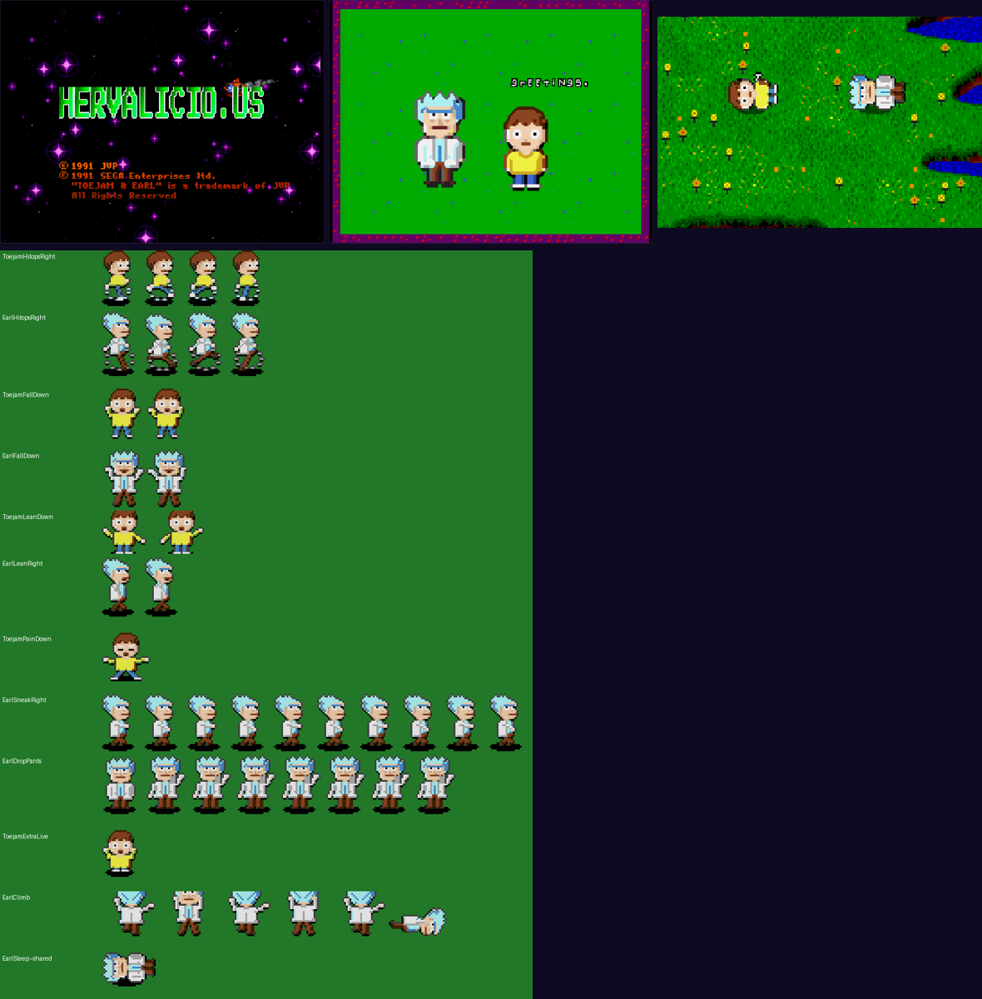

# Schwifty Jam: Rick & Morty Edition (Genesis)

A Rick & Morty conversion of ToeJam & Earl (REV 02), built from the sprites of [Schwifty Jam](https://schwifty-jam.vercel.app/). Nothing is hand-patched: `build_port.py` regenerates everything from the original ROM, the Schwifty Jam art and the tables in these files.

```
node dump_sprites.mjs out/sprites.json   # runs Schwifty Jam's own pix.js, so the art matches pixel for pixel
python3 build_port.py                    # -> build/rick-and-morty.md + .ips, copied to ../../web/
python3 preview.py build/rick-and-morty.md out.png Spr_ToejamWalkDown ...   # look at sheets inside a built ROM
python3 tools/pose_sheet.py poses.png    # every puppet pose on one sheet
python3 tools/music_decode.py ../../rom/original.md songs   # the original music, decoded
```

Needs Node 18+, Python 3 with Pillow, and the toolkit's own setup (see `../../README.md`). The build is deterministic: the same ROM and these files always give the same patch. `build_port.py` refreshes `../../web/patches/rick-and-morty.ips`, the patch the web player applies; commit it along with the change that produced it.


## What changes

| Original | Port | How |
|---|---|---|
| ToeJam (P1) | **Morty** | All 60-odd animations. Walking uses Schwifty Jam's walk frames. Other moves are posed by `puppet.py`/`poses.py`, which redraw arms and legs on your body grids: spinning-legs running, arms-up falling, windmilling at edges, sneaking, pain, leaping, diving, climbing, throwing, high-fives, reading, cheering, hula. Effects go on top (`fx.py`): wings, spring shoes, rocket boots, ghost, zap x-ray, sleeping, flattened. Every frame gets new sprite boxes fitted to the art, so nothing is cropped. |
| Earl (P2) | **Rick** | Same treatment. Morty/Rick map to ToeJam/Earl like Schwifty Jam's stats (Morty quick, Rick tough). |
| Little Devil | Cronenberg | `CREATURES` in `build_port.py`. Creatures have side views only. |
| Dentist | Gromflomite cop | |
| Shopping-cart mom | Snuffles | |
| Boogeyman | Scary Terry | Keeps the shimmering invisible state. |
| Wiseman (gives presents) | Mr. Poopybutthole | |
| Hula dancer (friendly) | Mr. Meeseeks | |
| HUD "TOEJAM/EARL IS A" + portraits | "MORTY/RICK IS A" + R&M heads | `hud.py` |
| Boot "SEGA" logo | "HERVALICIO.US" with the same palette-cycling shine, in portal green | `boot.py` (patches the logo routine's size/pointer operands) |
| Music (all 6 level songs + breakdowns) | Schwifty Jam's groove (104 BPM; bass, Em7/D7 stabs, lead, PCM kick/snare), a different key per level | `music.py`; format decoded with a byte-identical round trip of all 42 original tracks (`tools/music_decode.py`) |
| Ranks wiener…funklord | jerry, noob, summer, morty, beth, tiny, pickle, unity, rick | `script.py` |
| Present names, ship parts, menus, intro story, dialogue | R&M versions (Plumbus, Portal Fluid, Evil Morty, Space Cruiser parts…) | `script.py` |
| Title logo | "SCHWIFTY JAM / RICK & MORTY EDITION" | `title.py` (Press Start 2P, OFL) |
| Big ToeJam & Earl (title cycle, intro story) | 3x Rick & Morty (Scale3x) | `bigcast.py`, `title.py` |

## How the colors work

Sprites share four 16-color palette lines, and line 3 (players and most Earthlings) is redesigned for the cast:
- It keeps black, white, greys, red and dark brown.
- It adds skin, Morty's yellow, Rick's cyan hair, blue and a green for Gromflomites.
- Everything else on that line is requantized (`tjmod build --requantize`), so untouched sprites keep their look as closely as the new palette allows.

The game runs the VDP in shadow/highlight mode: line 3 colors 14 and 15 aren't colors but darken/brighten operators. That gives characters the game's real see-through shadows (index 63 in the indexed sheets), and character art never uses those two slots.

Cronenbergs need pink, so they're drawn on line 2. The hardware sprites switch lines automatically, with a dithered shadow since there's no operator off line 3.

The title screens have their own palette; lines 2 and 3 there become Rick's and Morty's (`bigcast.py`).

## Not done yet

- **Intro rocketship:** the big ship in the intro is still ToeJam & Earl's rocket. Same for the ship-piece pickups.
- **Remaining Earthlings:** bees, chickens, hamster, nerds, mole, cupid, Santa, opera singer, ice cream truck and others keep their original art. They're only recolored to the new palette.
- **Level terrain:** grass, water and roads are unchanged (they fit Schwifty Jam anyway). The map's trees and cacti too.
- **Sound effects and voice samples:** unchanged.
- **Music variety:** all six songs are one groove in six keys. New songs are just note lists in `music.py`. There's no volume command, so FM timbre comes from the game's patches (bass 4, lead 2, chords 8).
- **Ending:** the ending on Funkotron (families, Trixie) is partly converted.

Share the patch (`build/rick-and-morty.ips`, also at `web/patches/`), never the ROM.


